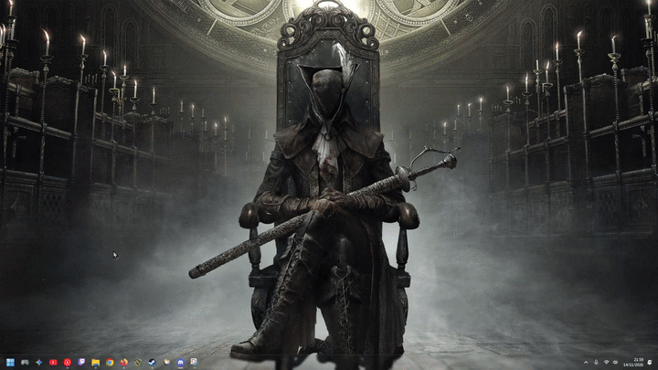

# GameBox

GameBox is a lightweight launcher that behaves like the Windows Start menu. It is non-intrusive, disappears on demand, and features a clean Windows-style design. You can navigate and launch your games using a mouse or a controller.

---

## Features

- **Lightweight & Clean**: Works just like the Windows Start menu, staying out of your way until you need it.
- **Gamepad-First Navigation**:
  - Open and close the launcher from anywhere using `Start + Select`.
  - Navigate the game grid using the D-Pad or Left Analog Stick.
  - `A` to launch the primary game.
  - `X` to launch the secondary/modded executable.
  - `Y` for game info and achievements.
  - `B` to hide the application.
  - Badge indicators (`A`, `X`, `Y`) appear above the action buttons only when a controller is connected.
- **Windows 11 Fluent Design**: Acrylic blur, rounded corners, and dark mode.

---

## Gamepad Controls

| Button / Combination | Action |
| --- | --- |
| `Start` + `Select` (Back) | Open or close GameBox |
| `D-Pad` or `Left/Right Stick` | Navigate library grid |
| `A` | Launch game |
| `X` | Launch secondary executable |
| `Y` | View game info |
| `B` | Hide application |

---

## Planned Features

- **Game Info Window**: Add a dedicated info and achievement view when pressing `Y`.
- **Controller Vibration & Power Off**: Add features to vibrate or turn off connected controllers from the UI (the main challenge is finding a reliable unique ID for every controller).
- **More Storefronts**: Add support for Epic Games Store and other digital stores.
- **Light Theme**: Add a light mode option for the UI.

---

## Known Issues and Bugs

- **Taskbar Pinning**: Pinning the companion executable to the taskbar cannot happen automatically and must be done manually.
- **Filter Bug**: If a filter is applied in the settings, only the filtered games are shown even if the UI text suggests all games are displayed.
- **Settings Tabs**: Some settings tabs are currently empty or disabled (for example, choosing specific controller types or overlays cannot be changed yet).
- **Second Monitor**: If the app is opened on a second monitor, it will be shown on the main monitor.

---

## AI Usage Disclosure and Credits

AI was used to help write the code for this project, but everything has been personally reviewed and tested. Generative AI was never used for images or graphical assets. 

**Credits for assets used in GameBox:**
- **Xbox Achievement Icons**: Xbox
- **PlayStation Trophy Icons**: PlayStation
- **Steam Award Icons**: Steam *(Note: Neither the current icons nor the official Steam ones look quite right, so I am looking for better ones that match the overall style. If anyone wants to help with the graphics, any contribution is welcome!)*
- **Controller Icons**: icons8
- **Game Covers**: Steam and SteamGridDB